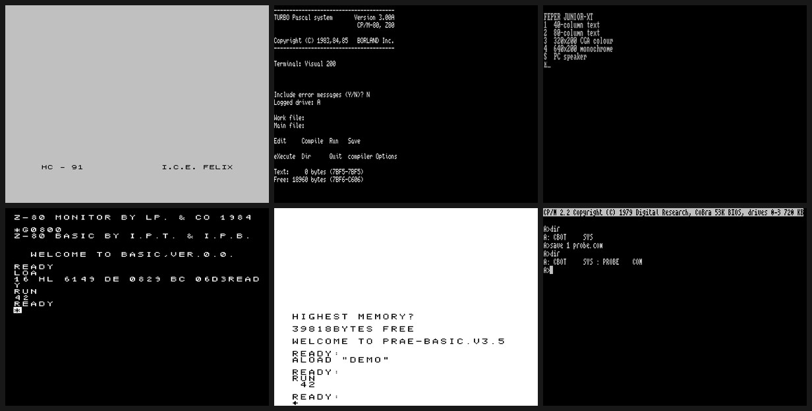

# MiSTerRO

[Română](README.ro.md)

Cores for [MiSTer](https://github.com/MiSTer-devel/Wiki_MiSTer/wiki) (the DE10-Nano FPGA board) of the Romanian computers of
the 1980s and 1990s: the HC family, the CIP, the TIM-S, the CoBra, the JET, the CUB Z, the aMIC, the PRAE-M and the
JUNIOR-XT. Each core is the machine's own logic and runs its original firmware; every core has been run on a real MiSTer.
With them comes M-CRT, a video preset for MiSTer.



## The cores

| Core | Maker | Models | SDRAM | Guide |
|---|---|---|---|---|
| **HC** | ICE Felix | HC-85, HC-88, HC-90, HC-91, HC-91 Plus (HC-128), HC-2000 | no | [HC](docs/hc/README.md) |
| **CIP** | Electronica | CIP-01, CIP-02, CIP-03, CIP-04 (experimental) | for the CIP-04 | [CIP](docs/cip/README.md) |
| **TIMS** | Timisoara | TIM-S, TIM-S Plus | 32 MiB or more | [TIM-S](docs/tims/README.md) |
| **COBRA** | ITCI Brasov | CoBra 64K and 80K, BASIC and CP/M | no | [CoBra](docs/cobra/README.md) |
| **JET** | Electromagnetica | JET | no | [JET](docs/jet/README.md) |
| **CUBZ** | ICE Felix | CUB Z, monitors 1.4 and 1.3, CP/M | no | [CUB Z](docs/cubz/README.md) |
| **AMIC** | ITC Bucuresti | aMIC, 16, 32 or 48 KiB of RAM | no | [aMIC](docs/amic/README.md) |
| **PRAE** | ITC Cluj-Napoca | PRAE-M, BASIC 3.6 and 3.5 | no | [PRAE](docs/prae/README.md) |
| **JUNIORXT** | FEPER | JUNIOR-XT, BIOS 4.0, 3.0 and 5.0 | yes | [JUNIOR-XT](docs/juniorxt/README.md) |

The [M-CRT preset](docs/preset/README.md) gives any MiSTer core soft pixel edges, light scanlines and a matching gamma curve.

Firmware is never patched, with the exceptions each guide names: the aMIC's archived ROM has two faults repaired, the
TIM-S Plus starts from a replacement bootstrap because its own is not archived, and the HC-88 boots a replacement CP/M
system disk. The [limitations](docs/NOTES.md#limitations) say what is not known or not built.

## Quick start

1. Download `MiSTerRO-<version>-<CORE>.zip` for each core you want; `MiSTerRO-<version>-MCRT.zip` is the preset.
2. Extract it onto the MiSTer card (`/media/fat`), preserving paths.
3. Choose the core under **Computers** in the MiSTer menu.

An archive holds the core (`_Computer/`), the machine's firmware, a demo and its support files (`games/<CORE>/`) and this
documentation (`docs/MiSTerRO/`). The firmware loads by itself when the core starts. Each guide's Start section tells
how to reach BASIC or CP/M and load the demo. No manuals or schematics come with the cores, and no other software: the
tapes and disks are your own. [Notes](docs/NOTES.md) lists what each archive puts on the card.

## Menu and keys

Every core has the same menu: the mounted disks and the tape first, then **System** (model, memory, startup, Load
firmware), **Ports & Controllers** and **Audio & Video**, then **Reset**. Every core has **Aspect ratio** (Original, Full
Screen, ARC1, ARC2) and **Scandoubler Fx** (None, HQ2x, CRT 25%, CRT 50%), and a **Monitor** choice where the machine had
one.

| Key | |
|---|---|
| F12 | The MiSTer menu (Win+F12 on the JUNIOR-XT) |
| F11 | Reset the machine (the Z80 cores; the JUNIOR-XT has Reset in its menu) |

The other keys are the machine's own; each guide gives the keys of its tape recorder and how the PC keyboard maps to
the machine's.

## Languages

The documentation is in English; this README is also available in [Romanian](README.ro.md).

## Documentation

- The guide of each core, linked above: Start, Options, Tapes and disks, Ports and controllers, Included files and Build,
  with the machine's hardware as the core builds it (`hardware.md`), where its firmware and media come from and what was
  checked (`validation.md`).
- [Notes](docs/NOTES.md): the files on the card, the firmware and media, and the limitations.
- [Changelog](docs/CHANGELOG.md): what each version changed.
- [Third-party components](docs/THIRD_PARTY.md), with the notices of the firmware and media.

## Building from source

The sources are in `src/`: one folder for each core (`core-<family>/`: the machine in `rtl/`, the MiSTer top level in
`mister/`, simulations in `sim/`, the project's own programs for the machine in `software/`, tools in `tools/`), the
modules the aMIC, PRAE, JET, CoBra and TIM-S share (`shared/romanian/`) and the preset (`preset-mcrt/`). The MiSTer
framework is a pinned submodule.

```
git submodule update --init --recursive
python tools/assets.py unpack MiSTerRO-<version>-assets.zip
cd src/core-hc
./tools/build.ps1 test        # simulations and runtime checks
./tools/build.ps1 quartus     # the bitstream
./tools/build.ps1 package     # dist/HC.zip, the verified package
```

The firmware, tapes and disks are not part of the source: the release's assets archive holds them, and
`tools/assets.py` puts them in place. On Windows the tools run in WSL Debian; on Linux `python3 tools/build.py` takes the
same actions. They need Python 3 with Pillow, Verilator, Icarus Verilog, Pasmo, make, a C++ compiler and Docker, which
runs the GHDL and Quartus 17.0.2 Lite images pinned in each core's `dependencies.lock.json`. Each guide's Build section
has the core's own details. `python tools/package.py` makes the release archives in `dist/releases/` from the cores'
packages.

## License

GPL-3.0-or-later (`docs/LICENSE`). Third-party components are listed in `docs/THIRD_PARTY.md`.
