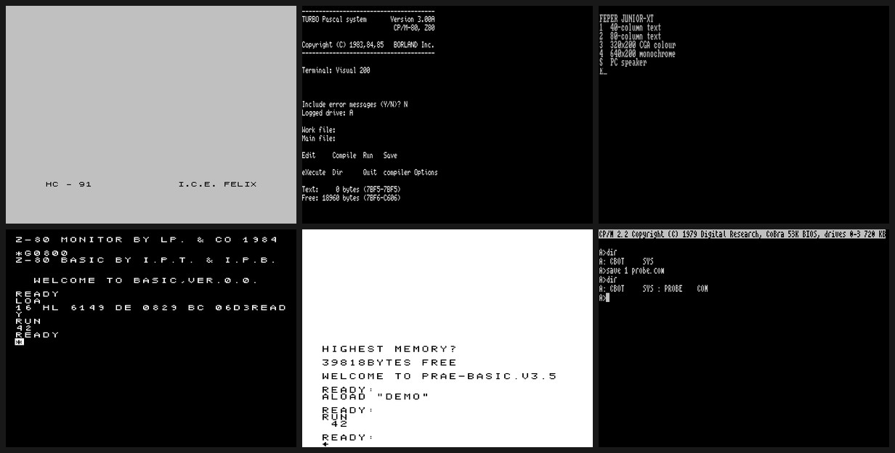

# MiSTerRO

[English](README.md)

Nuclee pentru [MiSTer](https://github.com/MiSTer-devel/Wiki_MiSTer/wiki) (placa FPGA DE10-Nano) ale calculatoarelor
românești din anii 1980 și 1990: familia HC, CIP, TIM-S, CoBra, JET, CUB Z, aMIC, PRAE-M și JUNIOR-XT. Fiecare nucleu
este logica proprie a calculatorului și rulează programul său original (firmware); fiecare nucleu a fost rulat pe un
MiSTer real. Alături de ele vine M-CRT, o presetare video pentru MiSTer.



## Nucleele

| Nucleu | Producător | Modele | SDRAM | Ghid (în engleză) |
|---|---|---|---|---|
| **HC** | ICE Felix | HC-85, HC-88, HC-90, HC-91, HC-91 Plus (HC-128), HC-2000 | nu | [HC](docs/hc/README.md) |
| **CIP** | Electronica | CIP-01, CIP-02, CIP-03, CIP-04 (experimental) | pentru CIP-04 | [CIP](docs/cip/README.md) |
| **TIMS** | Timișoara | TIM-S, TIM-S Plus | 32 MiB sau mai mult | [TIM-S](docs/tims/README.md) |
| **COBRA** | ITCI Brașov | CoBra 64K și 80K, BASIC și CP/M | nu | [CoBra](docs/cobra/README.md) |
| **JET** | Electromagnetica | JET | nu | [JET](docs/jet/README.md) |
| **CUBZ** | ICE Felix | CUB Z, monitoarele 1.4 și 1.3, CP/M | nu | [CUB Z](docs/cubz/README.md) |
| **AMIC** | ITC București | aMIC, 16, 32 sau 48 KiB de memorie RAM | nu | [aMIC](docs/amic/README.md) |
| **PRAE** | ITC Cluj-Napoca | PRAE-M, BASIC 3.6 și 3.5 | nu | [PRAE](docs/prae/README.md) |
| **JUNIORXT** | FEPER | JUNIOR-XT, BIOS 4.0, 3.0 și 5.0 | da | [JUNIOR-XT](docs/juniorxt/README.md) |

[Presetarea M-CRT](docs/preset/README.md) dă oricărui nucleu MiSTer margini moi ale pixelilor, linii de baleiaj discrete
și o curbă gamma potrivită.

Programele originale nu sunt modificate niciodată, cu excepțiile numite în fiecare ghid: memoria ROM arhivată a
aMIC-ului are două defecte reparate, TIM-S Plus pornește cu un încărcător înlocuitor, pentru că al său nu este arhivat,
iar HC-88 pornește de pe o dischetă de sistem CP/M înlocuitoare. [Limitările](docs/NOTES.md#limitations) (în engleză)
spun ce nu se cunoaște sau nu este construit.

## Pornire rapidă

1. Descărcați `MiSTerRO-<versiune>-<NUCLEU>.zip` pentru fiecare nucleu dorit; `MiSTerRO-<versiune>-MCRT.zip` este
   presetarea.
2. Extrageți arhiva pe cardul MiSTer (`/media/fat`), păstrând căile.
3. Alegeți nucleul la **Computers** în meniul MiSTer.

O arhivă conține nucleul (`_Computer/`), programul original al calculatorului, un program demonstrativ și fișierele
sale de suport (`games/<NUCLEU>/`) și această documentație (`docs/MiSTerRO/`). Programul original se încarcă singur la
pornirea nucleului. Secțiunea Start a fiecărui ghid arată cum se ajunge în BASIC sau în CP/M și cum se încarcă programul
demonstrativ. Nucleele nu sunt însoțite de manuale sau scheme și nici de alte programe: casetele și dischetele sunt ale
dumneavoastră. [Notele](docs/NOTES.md) (în engleză) enumeră ce pune fiecare arhivă pe card.

## Meniu și taste

Toate nucleele au același meniu: mai întâi dischetele montate și caseta, apoi **System** (model, memorie, pornire,
Load firmware), **Ports & Controllers** și **Audio & Video**, apoi **Reset**. Fiecare nucleu are **Aspect ratio**
(Original, Full Screen, ARC1, ARC2) și **Scandoubler Fx** (None, HQ2x, CRT 25%, CRT 50%) și, acolo unde calculatorul avea
un monitor propriu, o opțiune **Monitor**.

| Tastă | |
|---|---|
| F12 | Meniul MiSTer (Win+F12 la JUNIOR-XT) |
| F11 | Resetează calculatorul (nucleele Z80; JUNIOR-XT are Reset în meniu) |

Celelalte taste sunt ale calculatorului; fiecare ghid dă tastele casetofonului și corespondența dintre tastatura PC și
cea a calculatorului.

## Limbi

Documentația este în engleză; acest README este disponibil și în [engleză](README.md).

## Documentație

- Ghidul fiecărui nucleu, legat mai sus: Start, Options, Tapes and disks, Ports and controllers, Included files și
  Build, împreună cu descrierea calculatorului așa cum îl construiește nucleul (`hardware.md`), proveniența programelor
  și a mediilor și ce s-a verificat (`validation.md`).
- [Note](docs/NOTES.md): fișierele de pe card, programele originale și mediile, limitările.
- [Istoricul modificărilor](docs/CHANGELOG.md): ce a schimbat fiecare versiune.
- [Componente ale terților](docs/THIRD_PARTY.md), cu notele privind programele originale și mediile.

## Compilare din surse

Sursele sunt în `src/`: câte un dosar pentru fiecare nucleu (`core-<familie>/`: calculatorul în `rtl/`, nivelul
superior pentru MiSTer în `mister/`, simulări în `sim/`, programele proprii ale proiectului pentru calculator în
`software/`, unelte în `tools/`), modulele comune pentru aMIC, PRAE, JET, CoBra și TIM-S (`shared/romanian/`) și
presetarea (`preset-mcrt/`). Cadrul MiSTer este un submodul fixat.

```
git submodule update --init --recursive
python tools/assets.py unpack MiSTerRO-<versiune>-assets.zip
cd src/core-hc
./tools/build.ps1 test        # simulări și verificări de rulare
./tools/build.ps1 quartus     # fișierul pentru FPGA
./tools/build.ps1 package     # dist/HC.zip, pachetul verificat
```

Programele originale, casetele și dischetele nu fac parte din surse: le conține arhiva de resurse a versiunii
(`-assets.zip`), iar `tools/assets.py` le pune la locul lor. Pe Windows uneltele rulează în WSL Debian; pe Linux
`python3 tools/build.py` primește aceleași acțiuni. Sunt necesare Python 3 cu Pillow, Verilator, Icarus Verilog, Pasmo,
make, un compilator C++ și Docker, care rulează imaginile GHDL și Quartus 17.0.2 Lite fixate în fișierul
`dependencies.lock.json` al fiecărui nucleu. Secțiunea Build a fiecărui ghid are detaliile nucleului.
`python tools/package.py` face arhivele versiunii în `dist/releases/` din pachetele nucleelor.

## Licență

GPL-3.0-or-later (`docs/LICENSE`). Componentele terților sunt enumerate în `docs/THIRD_PARTY.md`.
