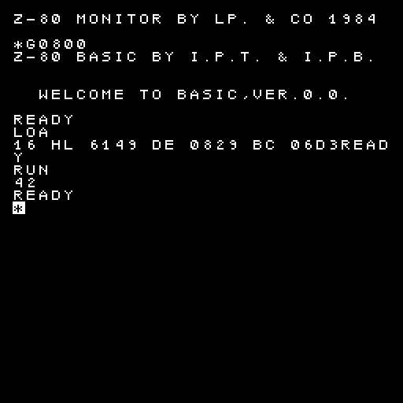

# AMIC validation

The bundled compatibility firmware starts BASIC in all three RAM configurations. Numbered programs run correctly; LOA loads the native MIC-recorded PZX through EAR and RUN returns 42. Native Z80 code checks both PPIs and a full TX/RX, RTS/CTS and DTR/DSR loopback.

| FPGA check | Result |
| --- | --- |
| Target | Cyclone V 5CSEBA6U23I7, DE10-Nano |
| Minimum constrained slack | 0.246 ns |
| Logic | 16,641 / 41,910 ( 40 % ) |
| RAM blocks | 372 / 553 ( 67 % ) |
| Native runs | 5 passed |
| MiSTer hardware | Run on a DE10-Nano |

Shared gates cover 8255 modes 0/1/2, 8251 framing and modem flow control, all six 8253 modes, CTC interrupt priority, persistent printer jobs, display geometry and scrolling, SDRAM startup/refresh and cassette transport. The cassette RAM is checked at every byte of its 256 KiB capacity, including upload gaps and overflow rejection; TZX stop48 is checked in both modes.

The core's package (`dist/AMIC.zip`) includes the current native, peripheral, cassette and FPGA reports. Packaging rejects stale inputs and checks every member checksum, then verifies the standalone source export.

RBF SHA-256: `82088f2ea1867a4b706f5de03bde8fd83022f333ecf3f8a030e2f946883e0e0a`.

