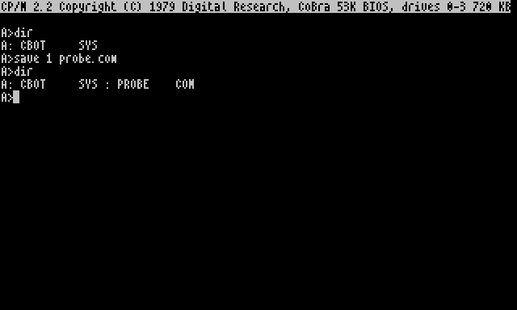

# COBRA validation

The original 64K and 80K bootstraps start BASIC. The 80K model loads the TAP and displays 42. Original CP/M boots through the CTC-driven 8272, creates PROBE.COM, lists it and finds it again after rebooting the saved disk.

| FPGA check | Result |
| --- | --- |
| Target | Cyclone V 5CSEBA6U23I7, DE10-Nano |
| Minimum constrained slack | 0.177 ns |
| Logic | 19,285 / 41,910 ( 46 % ) |
| RAM blocks | 466 / 553 ( 84 % ) |
| Native runs | 6 passed |
| MiSTer hardware | Run on a DE10-Nano |

Shared gates cover 8255 modes 0/1/2, 8251 framing and modem flow control, all six 8253 modes, CTC interrupt priority, persistent printer jobs, display geometry and scrolling, SDRAM startup/refresh and cassette transport. The cassette RAM is checked at every byte of its 256 KiB capacity, including upload gaps and overflow rejection; TZX stop48 is checked in both modes.

The floppy gate covers four-drive isolation, FM/MFM geometry, sector sizes, FORMAT, SCAN, deleted marks, terminal count, multi-track order, write protection and allocated-image bounds.

The core's package (`dist/COBRA.zip`) includes the current native, peripheral, cassette and FPGA reports. Packaging rejects stale inputs and checks every member checksum, then verifies the standalone source export.

RBF SHA-256: `e48324ac36906cb415ef09a45d36c5c3191ff2b26f8774fc8d8cb38fcfffc23b`.

