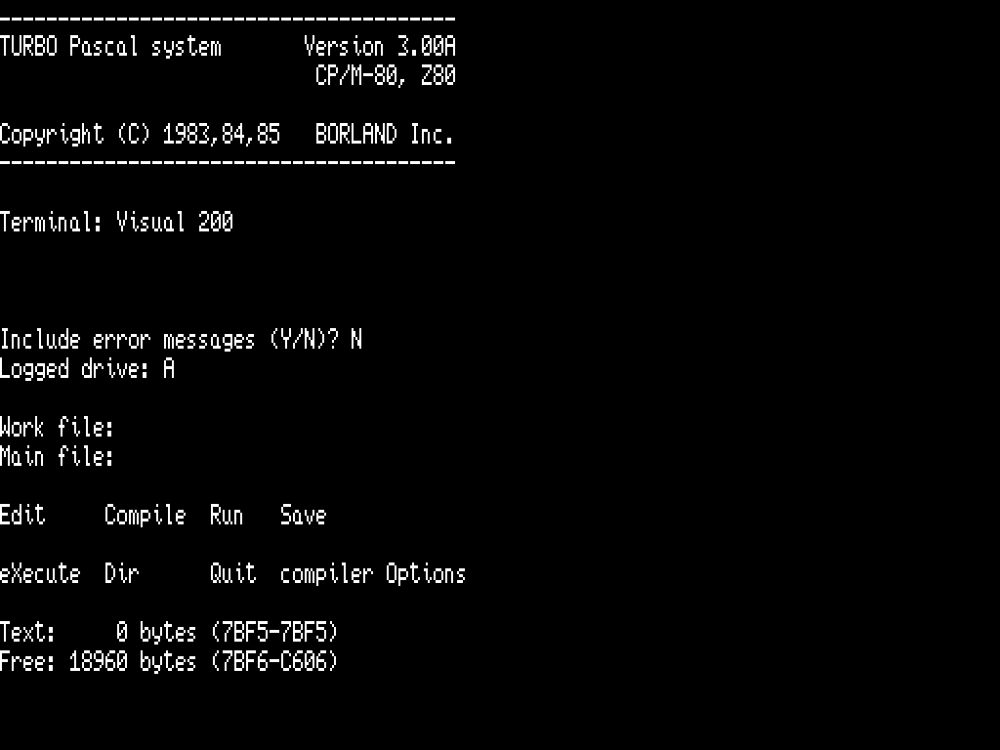

# CUBZ for MiSTer

ICE Felix CUB Z with its original monitor and CP/M software: 2.5 MHz Z80, 64 KiB
system RAM, 16 KiB bitmap RAM, floppy DMA, the two serial lines of the main board's
Z80 SIO and the user's Z80 PIO of the GPZ board. It uses on-chip RAM and does not
require SDRAM.

## Start

1. Extract `MiSTerRO-<version>-CUBZ.zip` onto the MiSTer card, preserving paths.
2. Select **CUBZ** under Computers. The original v1.4 firmware loads automatically;
   with no disk mounted, it displays `cubZ V1.4` and the monitor prompt `.`.
3. Mount `games/CUBZ/demo.dsk` in **Floppy A**, then **Reset** to boot CP/M.

## Options

| Menu | Option | Choices |
| --- | --- | --- |
| System | Load firmware | `boot.rom` (v1.4) or `firmware-v13.rom` (v1.3); a change resets the machine |
| Ports & Controllers | User port | Serial B, PIO port A |
| Audio & Video | Monitor | White, Green |
| Audio & Video | Aspect ratio | Original, Full Screen, ARC1, ARC2 |
| Audio & Video | Scandoubler Fx | None, HQ2x, CRT 25%, CRT 50% |

## Tapes and disks

The supplied demo is an original CP/M floppy; CUB Z has no cassette interface.
Two writable DSK drives are exposed as **Floppy A** and **Floppy B**. The bundled
disk retains its original Extended DSK sector information. Make a copy of the
disk before saving your own files.

## Ports and controllers

F11 resets and F12 opens the MiSTer menu. Normal US keyboard, Shift, Caps Lock,
Ctrl, Enter, Backspace, Tab and Escape are translated through the native serial
keyboard protocol.

The Z80 SIO answers at `E0h–E3h` with its clocks from the CTC, as on the main
board. Channel A, the line with modem signals, uses MiSTer's UART pins. Channel B,
the serial printer line, uses the User port: RX pin 0, TX 1, RTS 2, CTS 3, DTR 4
and DCD 6. With **User port** set to **PIO port A**, pins 0 to 6 are bits 0 to 6
of port A of the GPZ board's Z80 PIO (`A0h–A3h`). These are FPGA logic-level
signals. The GPZ board's IEEE-488 controller is not included.

## Included files

`games/CUBZ/` contains `boot.rom` (v1.4), `firmware-v13.rom`, the CP/M `demo.dsk`, the keyboard and video timing PROMs under
`support/` and a checksum manifest (`bundle.json`).

## Build

See [hardware](hardware.md), [building](build.md), [validation](validation.md)
and [source provenance](sources.lock.json). Firmware, disk images and original
documents retain their original rights; see [licensing](licenses/README.md).

