# HC-family validation

One HC.rbf boots the three original resident BASIC ROMs in the actual T80/PS2 simulation.
Each displays 4 for PRINT 2+2, restarts through F11 and displays 6 for PRINT 3+3.
Live transitions HC85 to HC90, HC90 to HC91 and HC91 to HC85 retain the combined
firmware, show the correct banner and execute arithmetic in the selected ROM.

Independent units cover static and runtime model bus decoding, ROM protection,
RAM, keyboard/EAR, border/beeper/MIC, HC85 arbitration and the HC90/91 divider.
Video checks cover 835,584 pixels per BRIGHT configuration, including FLASH,
normal/bright ink/paper and blanking. Cassette tests cover autoplay, pulse
cadence, pause/resume, block navigation and overflow. Controller checks reject
individual/oversized firmware and verify reset and retained banks on switching.

Separate fixed-model diagnostics have received each original Serpenti BASIC
bootstrap through EAR. This does not certify completion of the large demo
machine-code recordings. Bundled media boundaries, XORs and locked SHA-256
hashes are checked during packaging.

## HC-88 runtime checks

The original 2048-byte bootstrap reads the replacement disk through the native
polled 8272 path. The suite checks drive-ready reporting, directory listing,
file reads, BDOS create/write/close/reopen/read/compare, a cylinder-79 seek,
and the native 512-pixel video/speaker demo. A separate run uses normal spindle
and step timing.

BASIC is loaded from disk through CP/M. Framebuffer checks require PRINT 2+2
to display 4, then an EAR-loaded BASIC program to display 7319. The cassette
uses normal pulse widths and a standard data block. F11 must return to the
original bootstrap and the written file must remain readable. These tests
use guest instructions and matrix key events; they do not intercept BIOS or
tape-loading calls.

Independent units check the separate 64 KiB system and 16 KiB video memories,
LOCK, automatic shadow paging, MOD1 overlays, I/O aliases, serial input/output,
drive selection and motor feedback. Serializer checks cover 835,584 low-resolution
pixels and 1,671,168 high-resolution pixels, including both attribute banks,
BRIGHT and FLASH.

The distribution includes `hc88-validation.json` and
`hc88-capture-validation.json`. The HC88 disk is a replacement, and its manual
and cassette are labelled family references. Completion of the full large demo
cassette and comparison with an original HC88 board remain separate checks.

## Expansion hardware checks

Native Z80 test programs cover all eight HC128 RAM banks, screen 5/7 isolation,
ROM selection, paging lock, AY register access and a generated tone at the audio
output. HC2000 checks cover both ROM banks, RAM at zero, the upper ROM overlay,
C5/C7 aliasing and configuration lock. Interface 1 checks cover automatic entry
and exit, local SRAM mirrors, UART polarity/readiness, joystick, motor feedback,
drive B selection and network WAIT held by an external peer.

The controller test formats and reads both drives and heads, writes and reads
sectors, checks fill bytes and CHRN metadata, and rejects write-protected or
oversized formats without changing adjacent data. Both 256- and 512-byte sector
layouts are exercised. Tape storage is checked at every byte of the full
256 KiB capacity, with upload gaps, partial-word flush, overflow and TZX stop48
behavior in both 48K and 128K modes.

## Original expansion firmware

HC85's original Interface 1 DOS formats the supplied 320K template, lists its
catalogue, saves a BASIC program, clears it with NEW, loads it again and displays
42 when RUN. The trace records 1,584 block reads and 1,523 persistent writes.
HC128's original editor enters 128 BASIC and displays 4 for PRINT 2+2.
HC2000's original resident BASIC displays 6 for PRINT 3+3 after F11.

HC90/91/128 boot the original 360K HC91 CP/M disk and execute DIR. HC91 enters
through its unchanged BASIC PRINT USR 14446 launcher; HC128 enters with BREAK
held during reset. These profiles use a labelled compatibility entry with the
unchanged original Rev-E BIOS. HC2000 uses its independently verified v1 ROM
and original 720K internal-drive system image. It creates CHECK.COM, lists
the saved file, selects B and lists the original HC91 360K disk supplied for
the v1 BIOS external-drive layout. A receives four persistent block writes;
B is read without modifying its image. All seven workflows require actual
framebuffer glyph matches and are recorded in `expansion-validation.json` and
`expansion-capture-validation.json`.

## Family FPGA build

Minimum constrained slack: 0.222 ns.

Resource use: 18,653 / 41,910 ALMs (45%), 528 / 553 M10K blocks (95%),
and 33 / 112 DSP blocks (29%). No SDRAM module is needed.

Bitstream SHA-256: `a8ff48d5cb6a0694619e5d00037267e978f0188d9d0d6a3dcb7d760b6469eed5`.

Packaging requires current source/runtime/FPGA evidence, checks every archive
checksum and reproduces the single HC Quartus project from the source export.
Detailed logs are under build/. The distribution includes family and FPGA receipts.

The core has been run on a physical MiSTer (DE10-Nano). Original counter
phases, analog intensity and HC90/91 operation still need comparison with the
original machines.
Framework external I/O retains upstream constraints.

## Captures

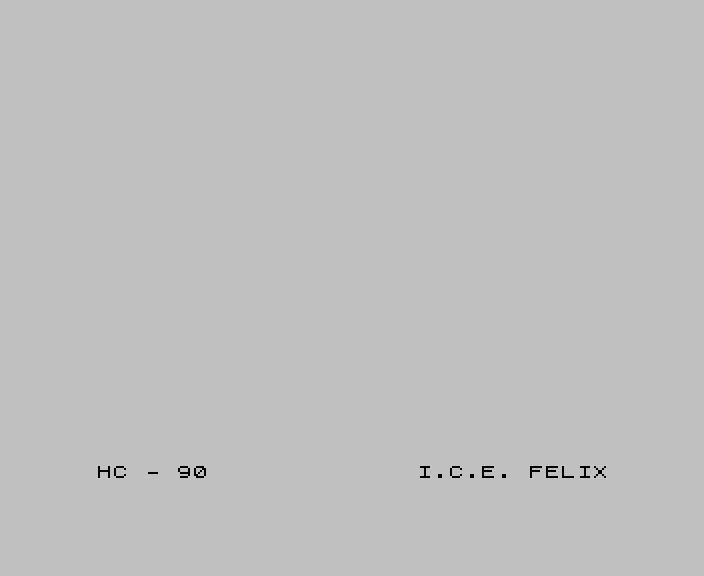

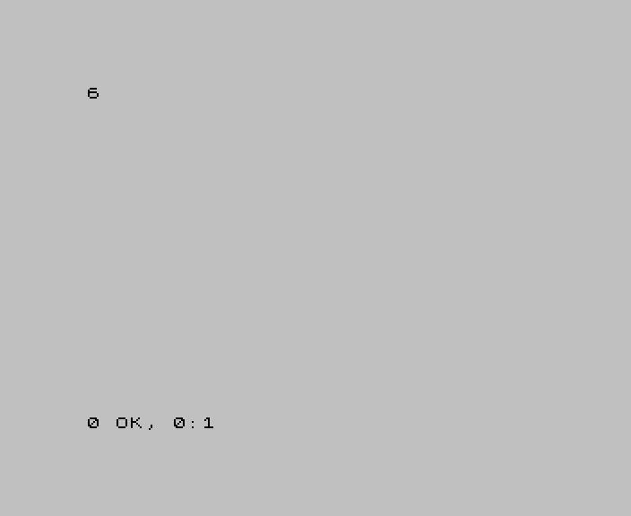

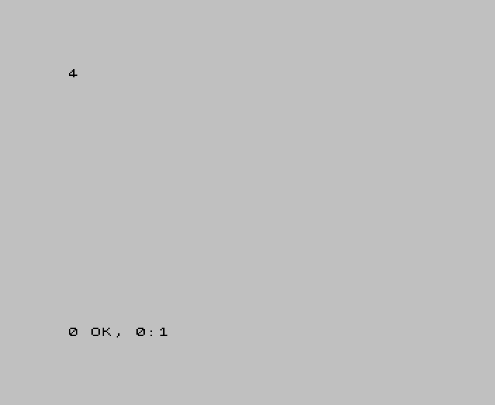

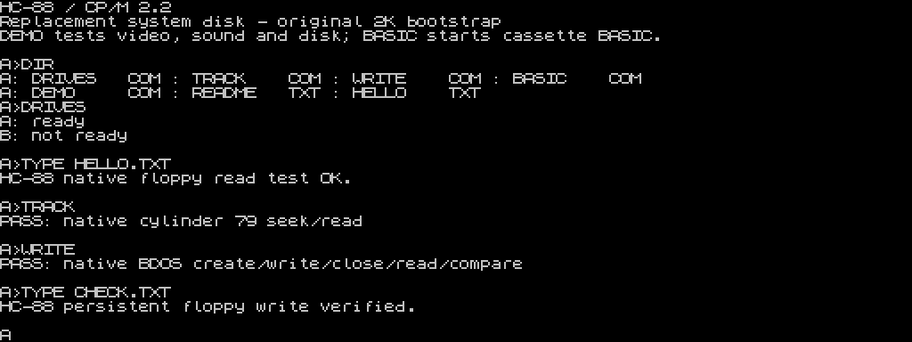

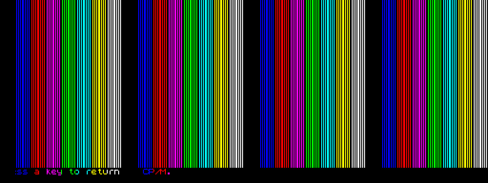

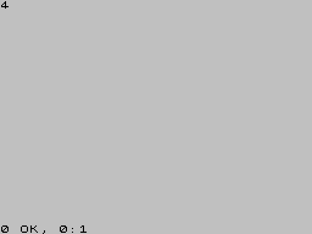

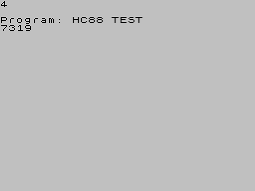

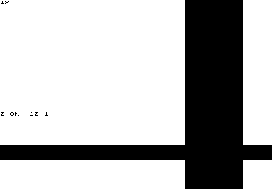

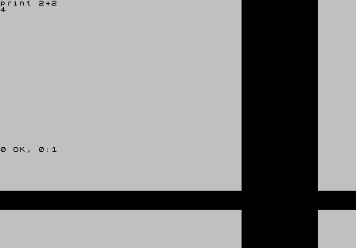

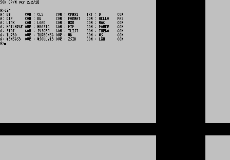

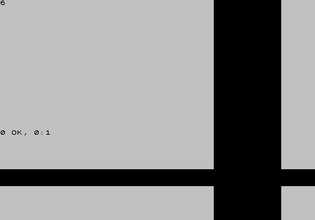

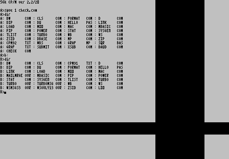
