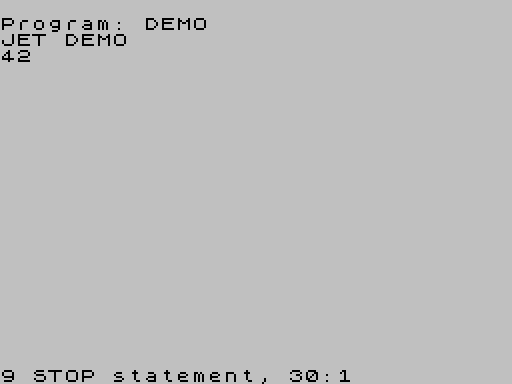

# JET validation

The original JET firmware loads the bundled TAP through EAR, autostarts the program and displays JET DEMO and 42. Native Z80 code checks keyboard, joystick and RAM access.

| FPGA check | Result |
| --- | --- |
| Target | Cyclone V 5CSEBA6U23I7, DE10-Nano |
| Minimum constrained slack | 0.201 ns |
| Logic | 16,389 / 41,910 ( 39 % ) |
| RAM blocks | 372 / 553 ( 67 % ) |
| Native runs | 2 passed |
| MiSTer hardware | Run on a DE10-Nano |

Shared gates cover 8255 modes 0/1/2, 8251 framing and modem flow control, all six 8253 modes, CTC interrupt priority, persistent printer jobs, display geometry and scrolling, SDRAM startup/refresh and cassette transport. The cassette RAM is checked at every byte of its 256 KiB capacity, including upload gaps and overflow rejection; TZX stop48 is checked in both modes.

A complete offline FPGA rebuild, without a Git checkout, produced an identical bitstream.

The core's package (`dist/JET.zip`) includes the current native, peripheral, cassette and FPGA reports. Packaging rejects stale inputs and checks every member checksum, then verifies the standalone source export.

RBF SHA-256: `3a13d394bae4d3d61ff09a831be2e7785719edf49f6e3d0c48e445b4e611ccb9`.

