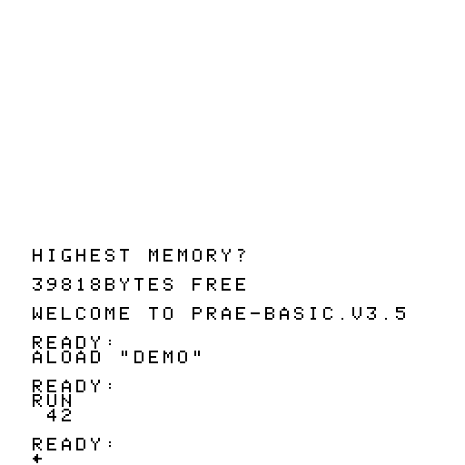

# PRAE validation

Both original CPU-visible BASIC 3.6 and 3.5 boot, accept the native keyboard, load the PZX through ALOAD and return 42 from RUN. Native Z80 code checks the keyboard, serial/cassette port and RAM.

| FPGA check | Result |
| --- | --- |
| Target | Cyclone V 5CSEBA6U23I7, DE10-Nano |
| Minimum constrained slack | 0.244 ns |
| Logic | 16,239 / 41,910 ( 39 % ) |
| RAM blocks | 388 / 553 ( 70 % ) |
| Native runs | 3 passed |
| MiSTer hardware | Run on a DE10-Nano |

Shared gates cover 8255 modes 0/1/2, 8251 framing and modem flow control, all six 8253 modes, CTC interrupt priority, persistent printer jobs, display geometry and scrolling, SDRAM startup/refresh and cassette transport. The cassette RAM is checked at every byte of its 256 KiB capacity, including upload gaps and overflow rejection; TZX stop48 is checked in both modes.

The core's package (`dist/PRAE.zip`) includes the current native, peripheral, cassette and FPGA reports. Packaging rejects stale inputs and checks every member checksum, then verifies the standalone source export.

RBF SHA-256: `02e0a5d89190a5d61ebb70e5a0308a1647cc6fe3fac56ab93043da58e6529747`.

