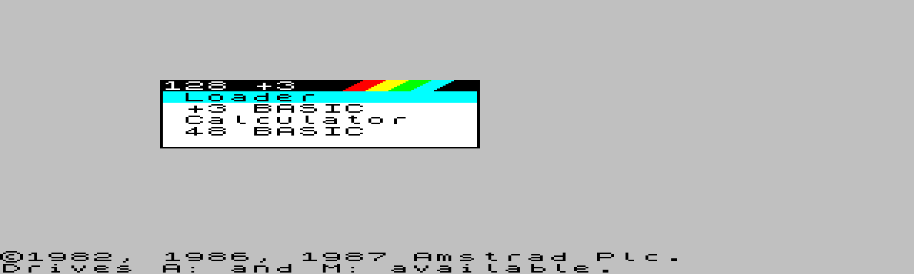

# TIMS validation

Original TIM-S loads and runs the TAP. Plus starts the unmodified +3 system through its labelled replacement bootstrap. Native Z80 diagnostics cover all twelve RAM banks, video pages, 4 MiB MICRONEXT memory, five modem-controlled serial channels, AY, floppy write/readback, printer output, keyboard modes and network NMI.

| FPGA check | Result |
| --- | --- |
| Target | Cyclone V 5CSEBA6U23I7, DE10-Nano |
| Minimum constrained slack | 0.246 ns |
| Logic | 22,936 / 41,910 ( 55 % ) |
| RAM blocks | 390 / 553 ( 71 % ) |
| Native runs | 5 passed |
| MiSTer hardware | Run on a DE10-Nano |

Shared gates cover 8255 modes 0/1/2, 8251 framing and modem flow control, all six 8253 modes, CTC interrupt priority, persistent printer jobs, display geometry and scrolling, SDRAM startup/refresh and cassette transport. The cassette RAM is checked at every byte of its 256 KiB capacity, including upload gaps and overflow rejection; TZX stop48 is checked in both modes.

The floppy gate covers four-drive isolation, FM/MFM geometry, sector sizes, FORMAT, SCAN, deleted marks, terminal count, multi-track order, write protection and allocated-image bounds.

All 65,536 encoded timer reload values and their rounded half-periods are checked against independent binary/decimal integer expressions. The 84 MHz MiSTer adapter also passes every packed tape-RAM address, transport controls and both stop48 modes with its nine-stage read pipeline.

The core's package (`dist/TIMS.zip`) includes the current native, peripheral, cassette and FPGA reports. Packaging rejects stale inputs and checks every member checksum, then verifies the standalone source export.

RBF SHA-256: `67bdca469cacb54ac686034abe093cc983a1b58833ed14e2bb21a08e2dc2a903`.

